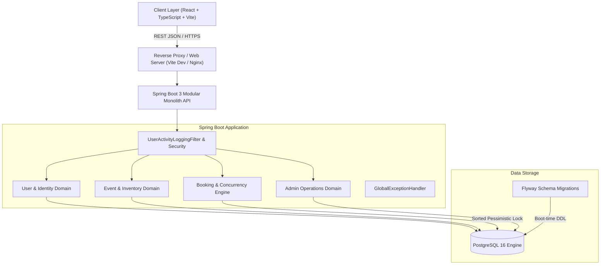
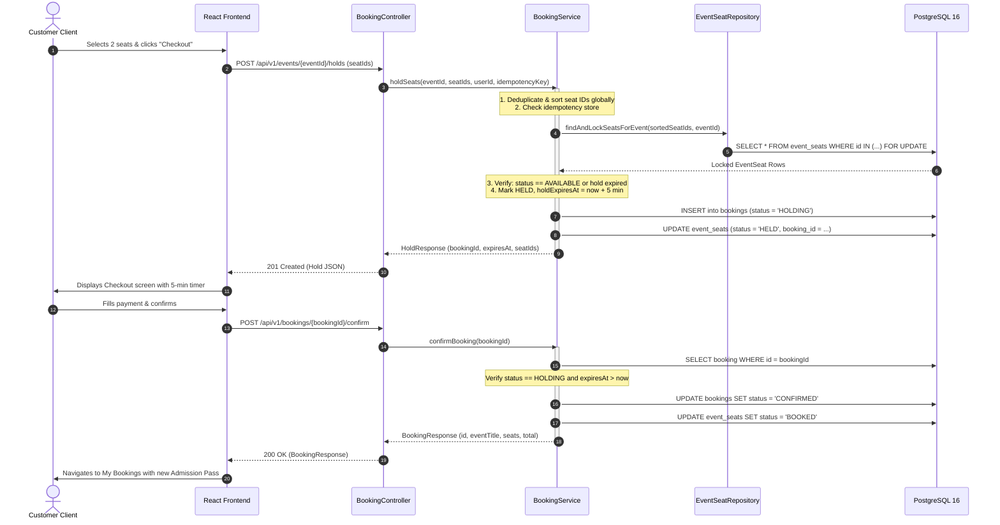

# SeatSure System Architecture

## 1. Architectural Philosophy

SeatSure adopts a **Modular Monolith** architecture. While microservices offer operational independence for massive enterprise teams, they introduce distributed transaction complexity (2-phase commits, saga orchestrations, distributed locks) that compromise ACID guarantees in high-concurrency seat reservation domains.

By organizing the application into strict, decoupled domain modules inside a single deployable unit backed by PostgreSQL, SeatSure achieves:
- **True Database ACID Atomicity**: Row-level locking and transaction isolation are enforced directly by the database engine without network latency or distributed consensus overhead.
- **Clear Domain Boundaries**: Business modules (`user`, `venue`, `event`, `booking`, `common`) interact via well-defined public interfaces and DTOs.
- **Future Microservice Extraction Path**: Each domain encapsulates its own repositories, entities, and services. If business growth demands service splitting, boundaries are already established.

---

## 2. High-Level System Architecture

---

## 3. Domain Module Breakdown

SeatSure is divided into explicit packages under `com.seatsure`:

### 3.1. User & Identity (`com.seatsure.user`)
- **Entities**: [`User`](file:///c:/Users/shambhoo/Desktop/SeatSure/backend/src/main/java/com/seatsure/user/User.java)
- **Role-Based Access Control (RBAC)**: Supports [`ROLE_CUSTOMER`](file:///c:/Users/shambhoo/Desktop/SeatSure/backend/src/main/java/com/seatsure/user/UserRole.java) and [`ROLE_ADMIN`](file:///c:/Users/shambhoo/Desktop/SeatSure/backend/src/main/java/com/seatsure/user/UserRole.java).
- **Responsibilities**: User profile management, authentication tokens, and audit user resolution.

### 3.2. Venue & Layout (`com.seatsure.venue`)
- **Entities**: [`Venue`](file:///c:/Users/shambhoo/Desktop/SeatSure/backend/src/main/java/com/seatsure/venue/Venue.java), [`VenueSeat`](file:///c:/Users/shambhoo/Desktop/SeatSure/backend/src/main/java/com/seatsure/venue/VenueSeat.java)
- **Responsibilities**: Models physical architecture (stadiums, auditoriums, concert halls), row configurations, physical seat numbering, and default seating categories.

### 3.3. Event & Inventory (`com.seatsure.event`)
- **Entities**: [`Event`](file:///c:/Users/shambhoo/Desktop/SeatSure/backend/src/main/java/com/seatsure/event/Event.java), [`EventSeat`](file:///c:/Users/shambhoo/Desktop/SeatSure/backend/src/main/java/com/seatsure/event/EventSeat.java)
- **Responsibilities**: Schedules performances, prices seats dynamically by tier (`VIP`, `PREMIUM`, `STANDARD`), and instantiates concrete inventory rows for each scheduled showtime.

### 3.4. Booking Engine (`com.seatsure.booking`)
- **Entities**: [`Booking`](file:///c:/Users/shambhoo/Desktop/SeatSure/backend/src/main/java/com/seatsure/booking/Booking.java), [`BookingItem`](file:///c:/Users/shambhoo/Desktop/SeatSure/backend/src/main/java/com/seatsure/booking/BookingItem.java)
- **Services**: [`BookingService`](file:///c:/Users/shambhoo/Desktop/SeatSure/backend/src/main/java/com/seatsure/booking/BookingService.java), [`HoldExpiryJob`](file:///c:/Users/shambhoo/Desktop/SeatSure/backend/src/main/java/com/seatsure/booking/HoldExpiryJob.java)
- **Responsibilities**:
  - Deterministic sorted lock acquisition (`SELECT ... FOR UPDATE`).
  - Temporary seat hold allocation (5-minute countdown window).
  - Booking confirmation & permanent inventory commitment.
  - Idempotent request replay via `Idempotency-Key`.
  - Hold cancellation and scheduled expiry cleanup.
  - User booking history and multi-pass retrieval.

### 3.5. Common & Cross-Cutting (`com.seatsure.common`)
- **Global Error Handling**: [`GlobalExceptionHandler`](file:///c:/Users/shambhoo/Desktop/SeatSure/backend/src/main/java/com/seatsure/common/error/GlobalExceptionHandler.java) mapping business exceptions to standard RFC 7807 problem details.
- **Audit Logging**: [`UserActivityLoggingFilter`](file:///c:/Users/shambhoo/Desktop/SeatSure/backend/src/main/java/com/seatsure/common/logging/UserActivityLoggingFilter.java) capturing HTTP requests, client IPs, response codes, and latency metrics.
- **CORS Configuration**: [`WebCorsConfig`](file:///c:/Users/shambhoo/Desktop/SeatSure/backend/src/main/java/com/seatsure/common/config/WebCorsConfig.java) securing origins.

---

## 4. End-to-End Booking Sequence Diagram

