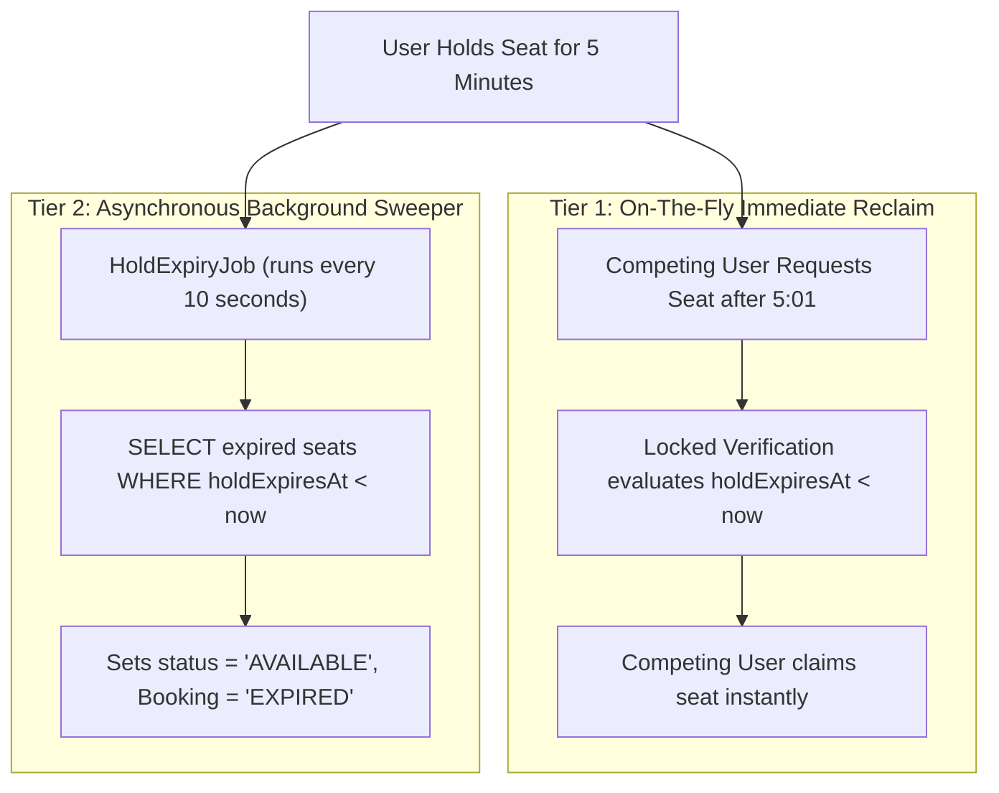

# Concurrency Control & Pessimistic Locking Engine

## 1. The Core Engineering Problem

In event ticketing, high concurrency spikes occur the instant ticket sales open. When hundreds of users simultaneously attempt to reserve adjacent seats, naive application architectures suffer from two catastrophic failure modes:

1. **The Double-Booking Anomaly**: Two concurrent HTTP requests read a seat as `AVAILABLE`. Both proceed to checkout, generating two confirmed tickets for a single physical venue seat.
2. **Database Deadlocks**: User A attempts to reserve seats `[S1, S2]`, while User B attempts to reserve seats `[S2, S1]`. User A acquires a lock on `S1` and requests `S2`. User B acquires a lock on `S2` and requests `S1`. The database engine detects a circular dependency and terminates one or both transactions.

---

## 2. Locking Strategy: Pessimistic vs. Optimistic

| Evaluation Factor | Optimistic Locking (`@Version`) | Pessimistic Row Locking (`SELECT ... FOR UPDATE`) |
| :--- | :--- | :--- |
| **Mechanism** | Checks version number upon update; rolls back if changed. | Acquires exclusive row write-locks before reading state. |
| **High Contention Behavior** | Severe abort/rollback storm; poor user experience. | Ordered serial execution; clean, deterministic resolution. |
| **Application Suitability** | Read-heavy, low-conflict domains (e.g., CMS, user profiles). | **Ticketing, financial transfers, inventory reservation**. |
| **SeatSure Decision** | Not chosen for reservation critical paths. | **Adopted as the foundational concurrency engine**. |

---

## 3. The Sorted Lock Acquisition Algorithm

To guarantee zero deadlocks across arbitrary multi-seat selections, SeatSure enforces **strict global deterministic ordering**:

```java
// Deduplicate and sort seat IDs in a stable order to prevent circular-wait deadlocks
List<UUID> sortedSeatIds = requestedSeatIds.stream().distinct().sorted().toList();
```

### Mathematical Proof of Deadlock Immunity
A deadlock requires four Coffman conditions:
1. Mutual Exclusion
2. Hold and Wait
3. No Preemption
4. **Circular Wait**

By imposing a strict total order $(S_1 < S_2 < \dots < S_n)$ on seat IDs across all incoming transactions, a circular dependency ($T_1 \to T_2 \to T_1$) is mathematically impossible because all transactions acquire locks in the identical monotonic sequence.

---

## 4. Query & Locking Implementation

The database lock is acquired through [`EventSeatRepository`](file:///c:/Users/shambhoo/Desktop/SeatSure/backend/src/main/java/com/seatsure/event/EventSeatRepository.java):

```java
@Lock(LockModeType.PESSIMISTIC_WRITE)
@QueryHints({@QueryHint(name = "jakarta.persistence.lock.timeout", value = "3000")})
@Query("SELECT s FROM EventSeat s WHERE s.id IN :seatIds AND s.event.id = :eventId")
List<EventSeat> findAndLockSeatsForEvent(
        @Param("seatIds") List<UUID> seatIds,
        @Param("eventId") UUID eventId
);
```

### PostgreSQL Execution Plan
When executed, Spring Data JPA compiles this into:
```sql
SELECT es.*, vs.* 
FROM event_seats es
JOIN venue_seats vs ON es.venue_seat_id = vs.id
WHERE es.id IN (?, ?) AND es.event_id = ?
FOR UPDATE OF es;
```
Any competing transaction requesting overlapping seats is paused by PostgreSQL's lock manager until the holding transaction commits or rolls back (capped by the 3,000 ms lock timeout).

---

## 5. State Verification Under Lock

Once exclusive write locks are held, [`BookingService`](file:///c:/Users/shambhoo/Desktop/SeatSure/backend/src/main/java/com/seatsure/booking/BookingService.java#L120-L140) verifies availability inside the atomic transaction:

```java
Instant now = Instant.now();

for (EventSeat seat : lockedSeats) {
    boolean isAvailable = seat.getStatus() == SeatStatus.AVAILABLE;
    boolean isExpiredHold = seat.getStatus() == SeatStatus.HELD &&
            seat.getHoldExpiresAt() != null &&
            seat.getHoldExpiresAt().isBefore(now);

    boolean isPartOfCurrentHold = holdId != null &&
            seat.getStatus() == SeatStatus.HELD &&
            holdId.equals(seat.getCurrentBookingId());

    if (!isAvailable && !isExpiredHold && !isPartOfCurrentHold) {
        throw new SeatUnavailableException(
            "Seat " + seat.getVenueSeat().getRowLabel() + "-" + 
            seat.getVenueSeat().getSeatNumber() + " is currently held or already booked."
        );
    }
}
```

### Availability States Explained
1. **`AVAILABLE`**: Seat is completely free.
2. **Expired Hold**: Seat was held by another user, but their 5-minute checkout window has elapsed (`holdExpiresAt < now`). The current user reclaims it immediately without waiting for a background worker.
3. **Current User Hold Edit**: If the user is modifying their own ongoing hold (e.g., adding or removing a seat), their previously held seats are preserved.

---

## 6. Two-Tier Hold Expiry Architecture

To ensure expired seats never remain stranded, SeatSure implements a **two-tier reclamation strategy**:



1. **Tier 1 (Zero-Latency Reclaim)**: If a user clicks on an expired seat, the locking transaction recognizes `holdExpiresAt < now` and grants the hold immediately.
2. **Tier 2 (Sweeper Worker)**: If an expired seat experiences no immediate user interest, [`HoldExpiryJob`](file:///c:/Users/shambhoo/Desktop/SeatSure/backend/src/main/java/com/seatsure/booking/HoldExpiryJob.java) sweeps the database every 10 seconds, resetting abandoned seats back to `AVAILABLE` for discovery.

---

## 7. Client Idempotency Engine

Network disconnects and mobile app retries can cause duplicate hold submissions. SeatSure supports the standard `Idempotency-Key` header:

```java
if (idempotencyKey != null && !idempotencyKey.isBlank()) {
    Optional<Booking> existing = bookingRepository.findByIdempotencyKeyAndUserId(idempotencyKey, user.getId());
    if (existing.isPresent()) {
        if (existingSeatIds.equals(sortedSeatIds)) {
            log.info("Idempotent request matched existing booking {}", existing.getId());
            return toHoldResponse(existing, sortedSeatIds);
        } else {
            throw new IdempotencyConflictException("Idempotency key reused with different payload.");
        }
    }
}
```

- **Exact Replay**: If the same key is submitted with the same seats, the existing active reservation is returned without error.
- **Key Hijacking / Conflict**: If the same key is submitted with different seats, an `IDEMPOTENCY_CONFLICT` (HTTP 409) is returned to prevent ambiguous state.

---

## 8. Concurrency Validation Suite

SeatSure includes automated multi-threaded concurrency tests using **Testcontainers** running a genuine PostgreSQL instance:

```java
@Test
void concurrentSeatHold_guaranteesSingleWinner() throws Exception {
    int concurrentThreads = 8;
    ExecutorService executor = Executors.newFixedThreadPool(concurrentThreads);
    CountDownLatch startGun = new CountDownLatch(1);
    AtomicInteger successCount = new AtomicInteger(0);
    AtomicInteger conflictCount = new AtomicInteger(0);

    for (int i = 0; i < concurrentThreads; i++) {
        executor.submit(() -> {
            try {
                startGun.await();
                holdSeats(targetSeatId);
                successCount.incrementAndGet();
            } catch (SeatUnavailableException ex) {
                conflictCount.incrementAndGet();
            }
        });
    }

    startGun.countDown();
    executor.shutdown();
    executor.awaitTermination(10, TimeUnit.SECONDS);

    assertThat(successCount.get()).isEqualTo(1);
    assertThat(conflictCount.get()).isEqualTo(concurrentThreads - 1);
}
```
Result: Exactly 1 transaction succeeds; all other competing threads receive `SeatUnavailableException` (HTTP 409).
