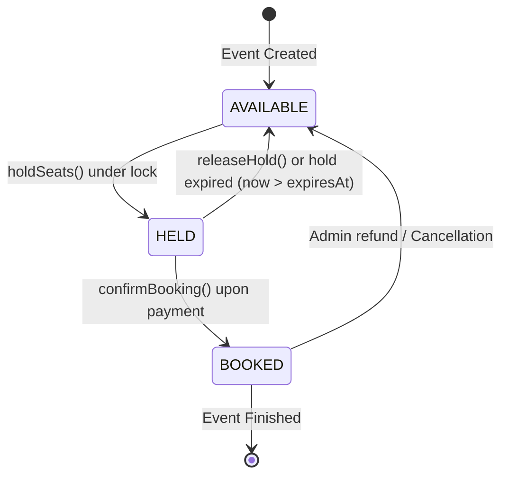
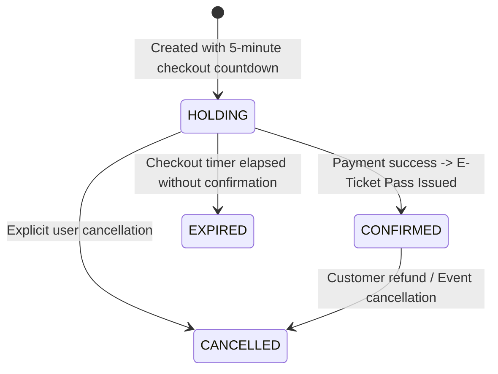

# PostgreSQL Database Schema & State Machines

## 1. Relational Architecture & ER Diagram

SeatSure uses **PostgreSQL 16** as the authoritative source of truth. Schema versioning is managed with **Flyway** migrations located under [`backend/src/main/resources/db/migration`](file:///c:/Users/shambhoo/Desktop/SeatSure/backend/src/main/resources/db/migration).

```mermaid
erDiagram
    USERS ||--o{ BOOKINGS : "places"
    VENUES ||--o{ VENUE_SEATS : "contains"
    VENUES ||--o{ EVENTS : "hosts"
    EVENTS ||--o{ EVENT_SEATS : "has inventory"
    VENUE_SEATS ||--o{ EVENT_SEATS : "instantiated as"
    BOOKINGS ||--o{ BOOKING_ITEMS : "contains"
    EVENT_SEATS ||--o{ BOOKING_ITEMS : "reserved as"

    USERS {
        uuid id PK
        varchar email UK
        varchar full_name
        varchar role
        timestamptz created_at
        timestamptz updated_at
    }

    VENUES {
        uuid id PK
        varchar name
        varchar address
        varchar city
        integer capacity
        timestamptz created_at
    }

    VENUE_SEATS {
        uuid id PK
        uuid venue_id FK
        varchar row_label
        integer seat_number
        varchar seat_type
        timestamptz created_at
    }

    EVENTS {
        uuid id PK
        uuid venue_id FK
        varchar title
        varchar category
        timestamptz event_date_time
        timestamptz doors_open
        varchar status
        timestamptz created_at
    }

    EVENT_SEATS {
        uuid id PK
        uuid event_id FK
        uuid venue_seat_id FK
        numeric price
        varchar status
        timestamptz hold_expires_at
        uuid current_booking_id
        timestamptz updated_at
    }

    BOOKINGS {
        uuid id PK
        uuid user_id FK
        uuid event_id FK
        varchar status
        numeric total_amount
        char currency
        varchar idempotency_key
        timestamptz expires_at
        timestamptz created_at
    }

    BOOKING_ITEMS {
        uuid id PK
        uuid booking_id FK
        uuid event_seat_id FK
        numeric unit_price
        timestamptz created_at
    }
```



---

## 2. Table Data Dictionary

### 2.1. `users`
Stores customer and administrator identity records.
| Column | Type | Constraints | Description |
| :--- | :--- | :--- | :--- |
| `id` | `UUID` | `PRIMARY KEY` | Globally unique user identifier. |
| `email` | `VARCHAR(255)` | `NOT NULL, UNIQUE` | Customer login email address. |
| `full_name` | `VARCHAR(255)` | `NOT NULL` | User's full display name. |
| `role` | `VARCHAR(50)` | `NOT NULL` | `ROLE_CUSTOMER` or `ROLE_ADMIN`. |
| `created_at` | `TIMESTAMPTZ` | `NOT NULL` | Account registration timestamp. |
| `updated_at` | `TIMESTAMPTZ` | `NOT NULL` | Profile modification timestamp. |

### 2.2. `venues` & `venue_seats`
Models physical venues and their permanent seat layouts.
- `venues.capacity`: Max physical capacity of the stadium/auditorium.
- `venue_seats.row_label`: Row identifier (e.g., `'A'`, `'B'`).
- `venue_seats.seat_number`: Integer position within row (e.g., `1`, `2`).
- `venue_seats.seat_type`: Tier classification (`'VIP'`, `'PREMIUM'`, `'STANDARD'`).
- Unique constraint: `UNIQUE (venue_id, row_label, seat_number)` prevents duplicate physical seat designations.

### 2.3. `events`
Scheduled shows, concerts, or conferences hosted at a venue.
- `status`: Lifecycle of event (`'ACTIVE'`, `'SOLD_OUT'`, `'CANCELLED'`, `'COMPLETED'`).

### 2.4. `event_seats` (The Core Inventory Table)
Instantiates concrete inventory for each event.
| Column | Type | Constraints | Description |
| :--- | :--- | :--- | :--- |
| `id` | `UUID` | `PRIMARY KEY` | Unique inventory seat identifier. |
| `event_id` | `UUID` | `FK -> events(id)` | Associated scheduled performance. |
| `venue_seat_id` | `UUID` | `FK -> venue_seats(id)` | Physical venue chair reference. |
| `price` | `NUMERIC(12,2)` | `NOT NULL` | Locked seat price in INR. |
| `status` | `VARCHAR(50)` | `NOT NULL` | `AVAILABLE`, `HELD`, or `BOOKED`. |
| `hold_expires_at` | `TIMESTAMPTZ` | `NULLABLE` | Expiry cutoff for temporary checkout hold. |
| `current_booking_id` | `UUID` | `NULLABLE` | Reference to active hold booking. |
| `updated_at` | `TIMESTAMPTZ` | `NOT NULL` | Row modification timestamp. |

### 2.5. `bookings` & `booking_items`
Records customer order lifecycle and itemized seat lines.
- `bookings.status`: `HOLDING`, `CONFIRMED`, `CANCELLED`, `EXPIRED`.
- `bookings.idempotency_key`: Client-supplied deduplication token.

---

## 3. High-Performance Indexing Strategy

To support sub-millisecond queries under heavy concurrent load, the following indices are maintained:

```sql
-- 1. Fast Seat Map Inventory Fetch
CREATE INDEX idx_event_seats_event_status 
ON event_seats(event_id, status);

-- 2. Sweeper Worker Fast Scan for Expired Holds
CREATE INDEX idx_event_seats_hold_expiry 
ON event_seats(status, hold_expires_at) 
WHERE status = 'HELD';

-- 3. Customer Booking History (Reverse Chronological Order)
CREATE INDEX idx_bookings_user_created 
ON bookings(user_id, created_at DESC);

-- 4. Idempotency Key Fast Lookup
CREATE UNIQUE INDEX idx_bookings_idempotency_user 
ON bookings(idempotency_key, user_id) 
WHERE idempotency_key IS NOT NULL;
```

---

## 4. Lifecycle State Machines

### 4.1. Seat Inventory State Machine (`SeatStatus`)



### 4.2. Booking Order State Machine (`BookingStatus`)


