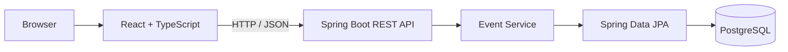
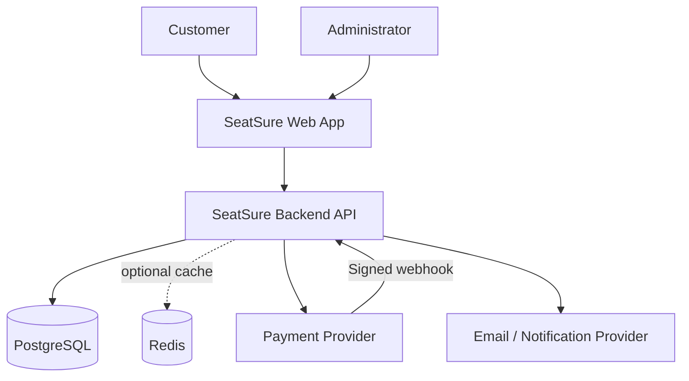
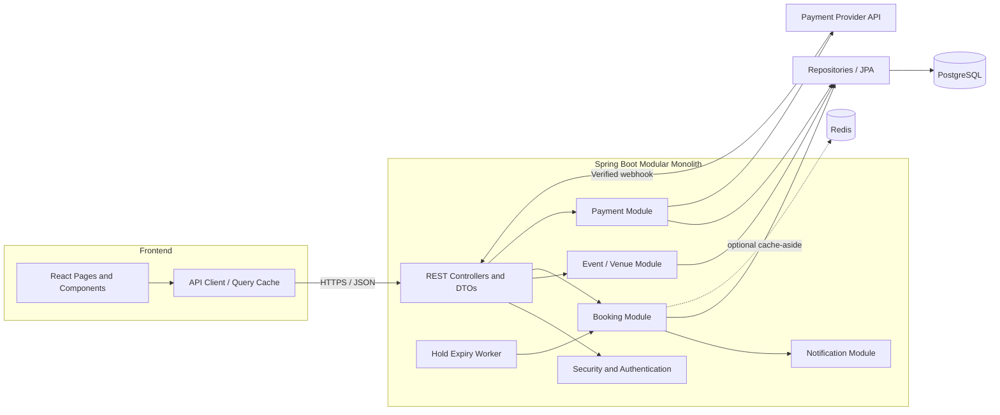
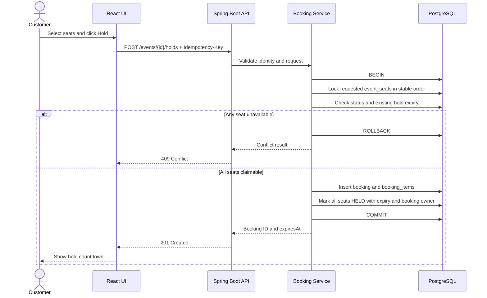
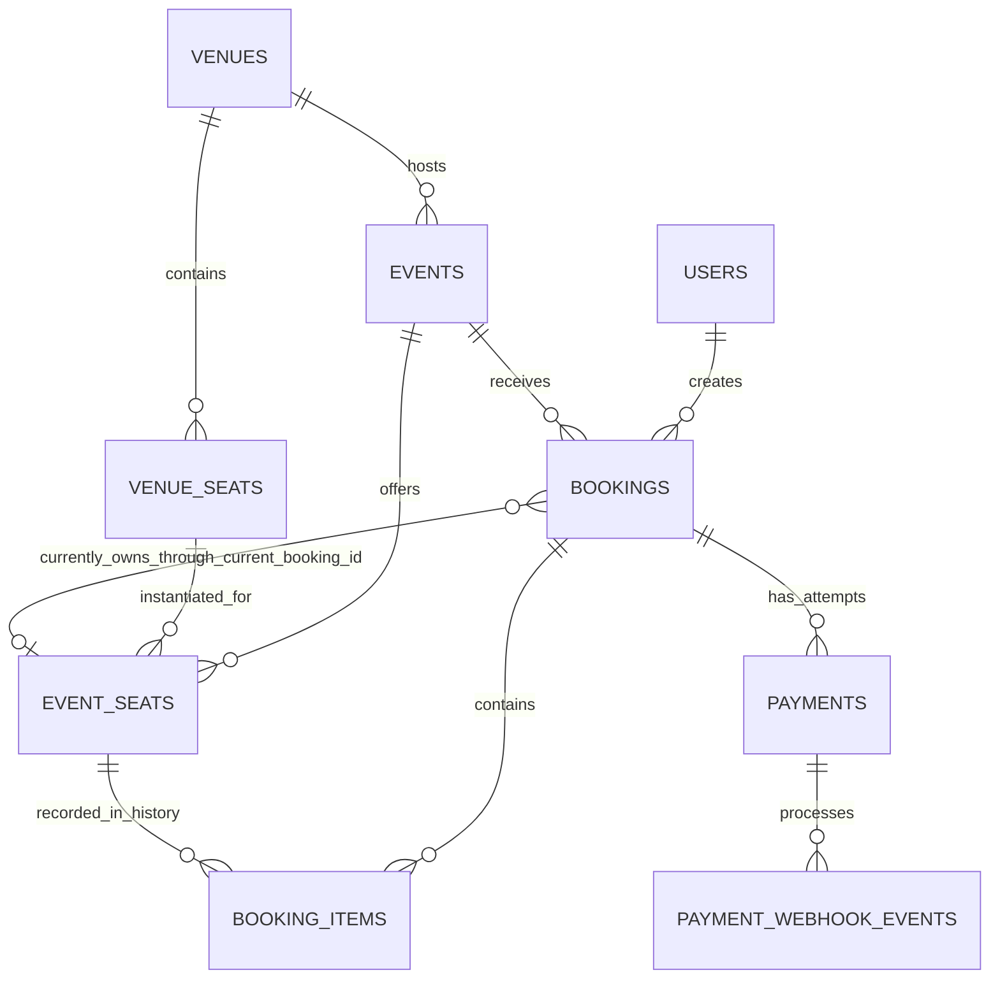
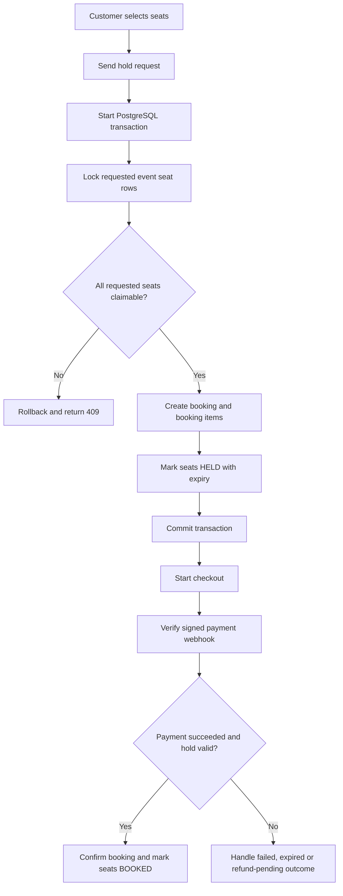

# SeatSure — Smart Ticket Booking Platform

> **Implementation blueprint** for a portfolio-quality full-stack application using Java, Spring Boot, React, PostgreSQL, and optional Redis.
>
> **Primary engineering goal:** make seat reservation correct under concurrent requests, then build a secure, testable, deployable product around that core.

- **Project type:** Full-stack web application
- **Architecture:** Modular monolith first
- **Backend:** Java 21, Spring Boot, Spring Security, Spring Data JPA, Flyway
- **Frontend:** React, TypeScript, Vite
- **Database:** PostgreSQL
- **Tests:** JUnit 5, Mockito, Spring Boot Test, Testcontainers, frontend tests, end-to-end tests
- **Delivery:** Docker, Docker Compose, GitHub Actions
- **Optional:** Redis for selected cache/rate-limit use cases; a payment provider's sandbox for checkout
- **Target build window:** approximately 8 weeks at 2–3 focused hours per day; extend the schedule if fundamentals or testing need more time

---

## Table of contents

1. [Project goal and scope](#1-project-goal-and-scope)
2. [Product requirements](#2-product-requirements)
3. [Prerequisites — learn these before implementation](#3-prerequisites--learn-these-before-implementation)
4. [Version 0: the simplest useful starting version](#4-version-0-the-simplest-useful-starting-version)
5. [Architecture and design decisions](#5-architecture-and-design-decisions)
6. [System design diagrams](#6-system-design-diagrams)
7. [Repository and directory structure](#7-repository-and-directory-structure)
8. [Database schema](#8-database-schema)
9. [API design](#9-api-design)
10. [Core booking and payment flows](#10-core-booking-and-payment-flows)
11. [Phase-by-phase implementation roadmap](#11-phase-by-phase-implementation-roadmap)
12. [Testing plan](#12-testing-plan)
13. [Security and reliability checklist](#13-security-and-reliability-checklist)
14. [Local development and configuration](#14-local-development-and-configuration)
15. [Deployment and CI/CD](#15-deployment-and-cicd)
16. [Redis: when and how to add it](#16-redis-when-and-how-to-add-it)
17. [Definition of done](#17-definition-of-done)
18. [Resume bullets](#18-resume-bullets)
19. [Interview questions to prepare](#19-interview-questions-to-prepare)
20. [Useful references](#20-useful-references)

---

## 1. Project goal and scope

SeatSure lets customers discover events, choose seats, temporarily hold them, complete checkout, and view their tickets. Administrators manage venues, physical seating layouts, events, prices, and booking reports.

This should not be only a CRUD demo. Its strongest engineering story is the end-to-end booking lifecycle: **two customers can request the same seat simultaneously, but at most one can successfully own the active reservation**.

### Primary users

**Customer**

- Register, sign in, and sign out.
- Browse and filter events.
- Open event details and view a seat map.
- Select one or more seats and hold them for a limited period.
- Checkout, view booking status, and access a ticket after confirmation.
- View booking history and request cancellation when policy allows.

**Administrator**

- Create and manage venues and physical seats.
- Create, publish, update, or cancel events.
- Set event-specific seat prices.
- View bookings and basic sales summaries.

**System**

- Enforce reservation consistency in PostgreSQL.
- Release expired holds safely.
- Process payment results idempotently.
- Record important state changes and operational errors.

### In scope

- A responsive React application.
- REST API built with Spring Boot.
- PostgreSQL-backed relational model and versioned migrations.
- Role-based access control.
- Event-seat inventory generated for each event.
- Temporary seat holds and expiry.
- Checkout using a mock payment adapter first, then a provider sandbox if time allows.
- Booking history and a basic ticket view, optionally with a QR code.
- Automated tests, Docker, CI, and deployment documentation.

### Out of scope for the first release

- Microservices, Kubernetes, a service mesh, and multi-region deployments.
- A custom payment-card vault. Do not collect or store raw card details.
- Complex seat maps with every possible auditorium shape.
- Dynamic pricing, loyalty points, resale, waiting lists, or multiple currencies beyond a simple currency field.
- Redis as the source of truth for seat availability.

### Success criteria

1. A developer can run the project from the README.
2. A customer can browse events and see seats.
3. A customer can hold available seats and receive a clear conflict when seats are no longer available.
4. Concurrent integration tests prove that a seat cannot be actively held or booked by two bookings at once.
5. Payment retries and duplicate webhooks do not accidentally create duplicate confirmations.
6. Authorization prevents one customer from reading another customer's booking.
7. The project has a working demo, useful tests, documented architecture, and CI checks.

---

## 2. Product requirements

### Functional requirements

| ID | Requirement | Priority |
|---|---|---|
| FR-01 | List events and view event details | MVP |
| FR-02 | Show a seat map and seat prices for an event | MVP |
| FR-03 | Register, log in, log out, and identify the current user | MVP before customer bookings |
| FR-04 | Reserve multiple seats atomically for a limited period | MVP |
| FR-05 | Return a conflict when any requested seat cannot be claimed | MVP |
| FR-06 | Release expired reservations | MVP |
| FR-07 | Checkout with a mock payment implementation | MVP |
| FR-08 | View booking status and booking history | MVP |
| FR-09 | Admin can create venues, seats, and events | MVP; seed data is acceptable for the first slice |
| FR-10 | Verify payment provider webhooks and ignore duplicate delivery | Next milestone when provider sandbox is added |
| FR-11 | Display ticket reference/QR code after confirmation | Enhancement |
| FR-12 | Support allowed cancellation/refund workflow | Enhancement after the booking lifecycle works |
| FR-13 | Cache selected read-heavy queries with Redis | Optional optimization |

### Non-functional requirements

- **Consistency:** PostgreSQL transactions and constraints protect seat ownership.
- **Security:** authenticated endpoints enforce ownership and roles; password hashes and provider secrets are never exposed.
- **Reliability:** retryable operations are idempotent where required; failures are observable.
- **Maintainability:** controllers are thin, business rules live in services, and database schema changes use Flyway migrations.
- **Testability:** critical business rules run in automated tests using real PostgreSQL for locking/constraint behavior.
- **Usability:** seat state, booking state, errors, and expiry are clearly presented to the user.
- **Performance:** index the queries the application actually runs; measure before optimizing.

---

## 3. Prerequisites — learn these before implementation

You do not need to master every technology first, but you should be comfortable with the following.

### Prerequisite checklist (0/12)

#### Java
- [ ] OOP, interfaces, collections, exceptions, enums
- [ ] Generics, streams, `BigDecimal`, date/time API
- [ ] Basic dependency injection and annotations

#### SQL and databases
- [ ] `SELECT`, `JOIN`, `GROUP BY`, foreign keys, and indexes
- [ ] Primary keys, unique constraints, and normalization
- [ ] Transactions, `COMMIT`/`ROLLBACK`, and basic locking

#### Web development
- [ ] HTTP methods, status codes, JSON, and REST
- [ ] JavaScript promises, async/await, and TypeScript basics
- [ ] React components, props, hooks, forms, and routing

#### Developer tools
- [ ] Git branches, commits, and pull requests
- [ ] Maven, environment variables, and API clients such as Postman
- [ ] Basic Docker commands and PostgreSQL setup

---

## 4. Version 0: the simplest useful starting version

**Do not start with payments, Redis, QR tickets, or a complicated frontend.** First build one small end-to-end slice: PostgreSQL contains a seeded event and its seats, Spring Boot exposes them, and React displays them.

### Version 0 scope

- One local PostgreSQL database.
- One seeded venue and one seeded event.
- A set of seats for that event.
- `GET /api/v1/events` and `GET /api/v1/events/{eventId}/seats` endpoints.
- A React event list and simple seat-grid page.
- No real payment provider and no Redis.
- Authentication may be deferred until Version 1; do not expose real customer data in this unauthenticated prototype.

### Version 0 architecture



### Version 0 tasks

1. Create the Git repository and initial README.
2. Generate a Spring Boot project with Spring Web, Spring Data JPA, PostgreSQL Driver, Flyway, Validation, and test dependencies.
3. Create the initial migration for `venues`, `venue_seats`, `events`, and `event_seats`.
4. Add seed data via a development-only seed script or explicit local setup process.
5. Implement event-list and seat-map DTOs and endpoints.
6. Create the React app with a basic event list and seat grid.
7. Handle loading, empty, and API-error states.
8. Write at least one backend integration test for event listing and one for seat availability.
9. Add setup steps to the README and commit the working slice.

### Version 0 acceptance criteria

- [ ] `docker compose up -d postgres` starts PostgreSQL.
- [ ] Spring Boot starts and applies database migrations.
- [ ] `GET /api/v1/events` returns the seeded event.
- [ ] `GET /api/v1/events/{eventId}/seats` returns the event's seats and prices.
- [ ] React displays the event and the seat grid.
- [ ] The README explains how to run both applications.
- [ ] No secrets or personal data are committed.

At this point the project is intentionally small. Once the first slice works, extend it in the following order.

---

## 5. Architecture and design decisions

### 5.1 Start with a modular monolith

Deploy a single Spring Boot application, but separate code by business capability. This keeps the project understandable without preventing future extraction of modules if real scale requires it.

Main modules:

- `auth`: identity, login, roles, current-user information.
- `venue`: venues and reusable physical seat layouts.
- `event`: event metadata, prices, event inventory, discovery/search.
- `booking`: holds, booking items, expiry, state transitions, history.
- `payment`: checkout abstraction, payment attempts, webhook processing.
- `notification`: confirmation email or in-app notification, if implemented.
- `admin`: administrative use cases and reports.
- `common`: security configuration, exceptions, API errors, clock/time utilities.

Keep the initial module boundaries in one codebase and one database. Avoid cross-module access to another module's private repository when an application service or public module method is more appropriate.

### 5.2 Source of truth

**PostgreSQL is authoritative for booking and seat ownership.** A frontend selection, Redis key, or delayed event cannot prove that a seat is available. Every reservation request must re-check the state under a database transaction and lock the relevant inventory rows.

### 5.3 Booking correctness principles

- Create/update the booking and claim all selected seats in one short database transaction.
- Lock seat rows while deciding which request wins.
- Use a consistent lock order for multi-seat requests to reduce deadlocks.
- If any requested seat cannot be claimed, roll back the entire request.
- Compute prices on the server and snapshot them in booking items.
- Do not hold database locks while making HTTP calls to a payment provider.
- Treat payment callbacks as at-least-once: verify signatures, deduplicate event IDs, and make state transitions idempotent.
- Treat expiration as a server-side rule. The browser countdown is informational only.
- If a payment is captured after the seat hold has become invalid, do not blindly confirm the booking; use a defined compensation path, typically refund-pending/refund.

### 5.4 State machines

**Event seat state**

- `AVAILABLE`: no active booking owns the event seat.
- `HELD`: a booking temporarily owns it until `hold_expires_at`.
- `BOOKED`: a confirmed booking owns it.

Valid transitions:

```text
AVAILABLE -> HELD -> BOOKED
                  -> AVAILABLE (hold expired or checkout abandoned)
BOOKED -> AVAILABLE (only through an authorized cancellation/refund policy)
```

For a status that is currently `HELD`, an expired booking is logically reclaimable even if a cleanup worker has not yet rewritten the seat row. The hold endpoint must check the booking expiry under lock; the background worker is cleanup, not the only correctness mechanism.

**Booking state**

Suggested states:

- `HOLDING`
- `PENDING_PAYMENT`
- `CONFIRMED`
- `EXPIRED`
- `PAYMENT_FAILED`
- `CANCELLED`
- `REFUND_PENDING`
- `REFUNDED`

Do not expose a generic API that lets a user send any state. State transitions should be explicit service operations. Payment state and booking state are related but different concepts; keep separate payment-attempt records.

### 5.5 Transaction boundaries

Use database transactions around local database changes. Keep external operations outside the transaction whenever possible:

1. Lock/check seats and create a hold in a transaction.
2. Commit the hold.
3. Ask the payment provider to create checkout outside the seat-locking transaction.
4. Process the signed provider webhook in its own transaction.
5. Update booking and seat states atomically after checking the current booking/hold state.

If a provider request times out, do not assume that the provider failed. Record a state that can be reconciled by querying the provider or processing a webhook.

---

## 6. System design diagrams

### 6.1 System context



### 6.2 Container / component architecture



### 6.3 Seat-hold sequence



### 6.4 Payment confirmation sequence

```mermaid
sequenceDiagram
    actor C as Customer
    participant UI as React UI
    participant API as Spring Boot API
    participant PG as PostgreSQL
    participant PSP as Payment Provider

    C->>UI: Checkout booking
    UI->>API: POST /bookings/{id}/checkout
    API->>PG: Validate owner/status; create payment attempt
    API->>PSP: Create checkout session (outside seat-lock transaction)
    PSP-->>API: Checkout URL/session reference
    API-->>UI: Checkout URL
    UI->>PSP: Complete hosted checkout
    PSP->>API: Signed payment webhook
    API->>API: Verify signature and event type
    API->>PG: Begin transaction; deduplicate event
    API->>PG: Lock booking and relevant seat rows
    alt Payment captured and reservation still valid
        API->>PG: Mark payment succeeded, booking confirmed, seats BOOKED
    else Payment captured after reservation became invalid
        API->>PG: Record refund-pending / reconciliation action
    else Payment failed
        API->>PG: Record failure and preserve/release seats by policy
    end
    API->>PG: Commit
```

### 6.5 Entity relationship diagram


The last relationship represents the optional `event_seats.current_booking_id` pointer. That pointer describes the current hold/confirmed owner. `booking_items` preserves history; it should not be treated as the source of truth for current seat ownership.

### 6.6 Booking and payment lifecycle flowchart



---

## 7. Repository and directory structure

Use a single repository (monorepo) for this portfolio project. It keeps local setup and CI straightforward.

```text
seatsure/
├── README.md
├── .gitignore
├── .env.example
├── docker-compose.yml
├── backend/
│   ├── pom.xml
│   ├── Dockerfile
│   └── src/
│       ├── main/
│       │   ├── java/com/seatsure/
│       │   │   ├── SeatSureApplication.java
│       │   │   ├── common/
│       │   │   │   ├── config/
│       │   │   │   ├── error/
│       │   │   │   ├── security/
│       │   │   │   └── time/
│       │   │   ├── auth/
│       │   │   │   ├── AuthController.java
│       │   │   │   ├── AuthService.java
│       │   │   │   ├── dto/
│       │   │   │   └── repository/
│       │   │   ├── user/
│       │   │   ├── venue/
│       │   │   │   ├── VenueController.java
│       │   │   │   ├── VenueService.java
│       │   │   │   ├── VenueRepository.java
│       │   │   │   ├── Venue.java
│       │   │   │   └── dto/
│       │   │   ├── event/
│       │   │   │   ├── EventController.java
│       │   │   │   ├── EventService.java
│       │   │   │   ├── EventRepository.java
│       │   │   │   ├── EventSeatRepository.java
│       │   │   │   ├── Event.java
│       │   │   │   └── dto/
│       │   │   ├── booking/
│       │   │   │   ├── BookingController.java
│       │   │   │   ├── BookingService.java
│       │   │   │   ├── HoldExpiryJob.java
│       │   │   │   ├── BookingRepository.java
│       │   │   │   ├── BookingItemRepository.java
│       │   │   │   ├── Booking.java
│       │   │   │   ├── BookingItem.java
│       │   │   │   ├── BookingStatus.java
│       │   │   │   └── dto/
│       │   │   ├── payment/
│       │   │   │   ├── PaymentController.java
│       │   │   │   ├── PaymentService.java
│       │   │   │   ├── PaymentGateway.java
│       │   │   │   ├── MockPaymentGateway.java
│       │   │   │   ├── Payment.java
│       │   │   │   ├── PaymentWebhookEvent.java
│       │   │   │   └── dto/
│       │   │   └── notification/
│       │   └── resources/
│       │       ├── application.yml
│       │       └── db/migration/
│       │           ├── V1__create_identity_and_venues.sql
│       │           ├── V2__create_events_and_inventory.sql
│       │           ├── V3__create_bookings_and_payments.sql
│       │           └── V4__add_booking_indexes.sql
│       └── test/java/com/seatsure/
│           ├── event/
│           ├── booking/
│           ├── payment/
│           └── security/
├── frontend/
│   ├── package.json
│   ├── vite.config.ts
│   ├── Dockerfile
│   ├── public/
│   └── src/
│       ├── app/
│       │   ├── App.tsx
│       │   └── router.tsx
│       ├── components/
│       │   ├── layout/
│       │   ├── feedback/
│       │   └── ui/
│       ├── features/
│       │   ├── auth/
│       │   ├── events/
│       │   ├── seats/
│       │   ├── bookings/
│       │   ├── checkout/
│       │   └── admin/
│       ├── lib/
│       │   ├── apiClient.ts
│       │   └── queryClient.ts
│       ├── hooks/
│       ├── types/
│       ├── styles/
│       └── main.tsx
├── docs/
│   ├── architecture.md
│   ├── database-schema.md
│   ├── booking-state-machine.md
│   ├── api-examples.md
│   ├── test-plan.md
│   └── screenshots/
├── learning/
│   ├── README.md
│   ├── 01-project-interview/
│   │   ├── explain-seatsure.md
│   │   ├── project-architecture.md
│   │   ├── booking-flow-explanation.md
│   │   └── project-challenges-and-tradeoffs.md
│   ├── 02-java-interview/
│   │   ├── oops-and-solid.md
│   │   ├── collections-and-generics.md
│   │   ├── exceptions-and-streams.md
│   │   └── java-multithreading.md
│   ├── 03-spring-boot-interview/
│   │   ├── spring-core-and-dependency-injection.md
│   │   ├── controllers-services-repositories.md
│   │   ├── spring-data-jpa-and-hibernate.md
│   │   └── spring-security.md
│   ├── 04-postgresql-interview/
│   │   ├── sql-joins-and-queries.md
│   │   ├── schema-design-and-indexes.md
│   │   └── transactions-and-isolation.md
│   ├── 05-rest-api-interview/
│   │   ├── http-methods-and-status-codes.md
│   │   ├── dto-validation-and-error-handling.md
│   │   └── authentication-and-authorization.md
│   ├── 06-system-design-interview/
│   │   ├── seat-booking-concurrency.md
│   │   ├── race-conditions-and-locking.md
│   │   ├── idempotency-and-retries.md
│   │   └── caching-and-redis.md
│   ├── 07-payment-interview/
│   │   ├── payment-lifecycle.md
│   │   ├── webhooks-and-duplicate-events.md
│   │   └── failures-and-recovery.md
│   ├── 08-testing-and-deployment/
│   │   ├── junit-mockito-testcontainers.md
│   │   ├── docker-and-environment-variables.md
│   │   └── github-actions-ci-cd.md
│   └── 09-resume-and-mock-interviews/
│       ├── resume-project-description.md
│       ├── technical-interview-questions.md
│       └── mock-interview.md
└── .github/workflows/
    └── ci.yml
```

### Structure rules

- Put business rules in service classes, not controllers or React components.
- Keep request/response DTOs separate from persistence entities.
- Use explicit enum types for state values.
- Keep migrations small and forward-only; do not edit a migration that has already been applied to a shared/deployed database.
- Avoid a `utils` package that becomes a dumping ground. Place code beside the module that owns it unless it is truly shared.
- Keep `MockPaymentGateway` available only in local/test configurations. Never allow a client to mark a production payment as successful by calling a public mock endpoint.

---

## 8. Database schema

Use PostgreSQL and Flyway migrations. The outline below shows the intended relational model; refine exact field sizes and indexes while writing the migrations.

### 8.1 Core tables

#### `users`

| Column | Type | Notes |
|---|---|---|
| `id` | UUID | Primary key |
| `email` | VARCHAR | Required, normalized, unique |
| `password_hash` | VARCHAR | Required for password authentication; never store raw passwords |
| `role` | VARCHAR / enum | `CUSTOMER` or `ADMIN` for the first release |
| `created_at` | TIMESTAMPTZ | Server-generated |
| `updated_at` | TIMESTAMPTZ | Server-generated |

#### `venues`

| Column | Type | Notes |
|---|---|---|
| `id` | UUID | Primary key |
| `name` | VARCHAR | Required |
| `city` | VARCHAR | Required |
| `address` | TEXT | Optional initially |
| `created_at` | TIMESTAMPTZ | Server-generated |

#### `venue_seats`

| Column | Type | Notes |
|---|---|---|
| `id` | UUID | Primary key |
| `venue_id` | UUID | FK to `venues` |
| `section` | VARCHAR | e.g. `BALCONY` |
| `row_label` | VARCHAR | e.g. `A` |
| `seat_number` | INTEGER | Positive |
| `seat_type` | VARCHAR | Optional, e.g. `STANDARD`, `PREMIUM` |

Unique constraint: `(venue_id, section, row_label, seat_number)`.

#### `events`

| Column | Type | Notes |
|---|---|---|
| `id` | UUID | Primary key |
| `venue_id` | UUID | FK to `venues` |
| `title` | VARCHAR | Required |
| `description` | TEXT | Optional |
| `starts_at` | TIMESTAMPTZ | Required; store instants consistently |
| `ends_at` | TIMESTAMPTZ | Optional, but if present should be after start |
| `status` | VARCHAR | `DRAFT`, `PUBLISHED`, `CANCELLED`, `COMPLETED` |
| `created_at` | TIMESTAMPTZ | Server-generated |

Do not allow a published event's venue/layout to change after bookings exist without an explicit migration/business rule. A venue seat is a reusable physical seat; `event_seats` is the inventory for one event.

#### `bookings`

| Column | Type | Notes |
|---|---|---|
| `id` | UUID | Primary key |
| `user_id` | UUID | FK to `users` |
| `event_id` | UUID | FK to `events` |
| `status` | VARCHAR | Booking state machine enum |
| `total_amount` | NUMERIC(12,2) | Server-computed, non-negative |
| `currency` | CHAR(3) | e.g. `INR` |
| `idempotency_key` | VARCHAR | Client request key; may be null for internal operations |
| `expires_at` | TIMESTAMPTZ | Required while booking is a hold/pending checkout |
| `created_at` | TIMESTAMPTZ | Server-generated |
| `updated_at` | TIMESTAMPTZ | Server-generated |

Recommended unique constraint: `(user_id, idempotency_key)`. PostgreSQL allows multiple null values in a standard unique constraint, but check the behavior of your chosen schema/version and use a partial unique index if needed. A repeated key with a different request payload should be rejected rather than silently reused.

#### `event_seats`

| Column | Type | Notes |
|---|---|---|
| `id` | UUID | Primary key |
| `event_id` | UUID | FK to `events` |
| `venue_seat_id` | UUID | FK to `venue_seats` |
| `price` | NUMERIC(12,2) | Event-specific price snapshot, non-negative |
| `status` | VARCHAR | `AVAILABLE`, `HELD`, `BOOKED` |
| `hold_expires_at` | TIMESTAMPTZ | Non-null only while `HELD` |
| `current_booking_id` | UUID | Nullable FK to `bookings`; current owner of a hold/confirmed seat |
| `updated_at` | TIMESTAMPTZ | Server-generated |

Constraints:

- Unique `(event_id, venue_seat_id)`.
- `price >= 0`.
- For `AVAILABLE`, `current_booking_id` and `hold_expires_at` must be null.
- For `HELD`, `current_booking_id` and `hold_expires_at` must be non-null.
- For `BOOKED`, `current_booking_id` must be non-null and `hold_expires_at` must be null.

A foreign key from `event_seats.current_booking_id` to `bookings.id` is a deliberate pointer to the current owner. Because of this reference, migrations should create `bookings` before `event_seats`, or add the foreign key in a later migration. The booking's `event_id` and event seat's `event_id` must be validated in the service layer; normal foreign keys alone do not prove those IDs match.

#### `booking_items`

| Column | Type | Notes |
|---|---|---|
| `id` | UUID | Primary key |
| `booking_id` | UUID | FK to `bookings` |
| `event_seat_id` | UUID | FK to `event_seats` |
| `unit_price` | NUMERIC(12,2) | Price at booking time |
| `created_at` | TIMESTAMPTZ | Server-generated |

Use unique `(booking_id, event_seat_id)`. Do **not** make `event_seat_id` globally unique in `booking_items`, because expired/cancelled historical bookings may reference the same seat that is later booked again. The current owner comes from `event_seats.current_booking_id`; booking items preserve history.

#### `payments`

| Column | Type | Notes |
|---|---|---|
| `id` | UUID | Primary key |
| `booking_id` | UUID | FK to `bookings` |
| `provider` | VARCHAR | `MOCK`, or real provider name |
| `provider_payment_id` | VARCHAR | Nullable until the provider creates an attempt/session |
| `status` | VARCHAR | e.g. `CREATED`, `PENDING`, `SUCCEEDED`, `FAILED`, `REFUND_PENDING`, `REFUNDED` |
| `amount` | NUMERIC(12,2) | Server-computed amount |
| `currency` | CHAR(3) | Currency code |
| `created_at` | TIMESTAMPTZ | Server-generated |
| `updated_at` | TIMESTAMPTZ | Server-generated |

Add a unique constraint on `(provider, provider_payment_id)` if provider IDs are unique within that provider. Treat nullable values intentionally.

#### `payment_webhook_events`

| Column | Type | Notes |
|---|---|---|
| `id` | UUID | Primary key |
| `provider` | VARCHAR | Provider name |
| `provider_event_id` | VARCHAR | Provider's stable event identifier |
| `received_at` | TIMESTAMPTZ | Server-generated |
| `processed_at` | TIMESTAMPTZ | Null until processed |
| `processing_status` | VARCHAR | `RECEIVED`, `PROCESSED`, `FAILED` |

Unique constraint: `(provider, provider_event_id)`. This provides deduplication, but business-state transitions must also be idempotent because deduplication rows and domain updates can encounter failures/retries.

### 8.2 Suggested indexes

Add indexes based on endpoint access patterns, including:

- `events(status, starts_at)` for published upcoming events.
- `venue_seats(venue_id)`.
- `event_seats(event_id, status)` for availability filters.
- `event_seats(current_booking_id)` for releasing all seats owned by a booking.
- `bookings(user_id, created_at DESC)` for booking history.
- `bookings(status, expires_at)` for the expiry worker.
- `booking_items(booking_id)`.
- `payments(booking_id, created_at DESC)`.

Do not add every conceivable index. Indexes speed reads but add write cost. Inspect query plans when you have representative data.

### 8.3 Migration order

One workable order is:

1. `users`, `venues`, and `venue_seats`.
2. `events` and `bookings` (both depend on users/venues/events as defined; if `bookings` references `events`, create `events` first).
3. `event_seats` with its current-booking foreign key.
4. `booking_items`, `payments`, and `payment_webhook_events`.
5. Check constraints and workload-driven indexes.

A practical exact sequence is: users/venues/venue_seats → events → bookings → event_seats → booking_items/payments/webhook_events → additional indexes/constraints.

### 8.4 Data integrity rules

- Normalize emails before enforcing uniqueness.
- Use UUID identifiers consistently in Java and PostgreSQL.
- Use `BigDecimal` in Java for currency; never `float`/`double` for money.
- Calculate total amount from locked inventory rows on the backend.
- Snapshot ticket price in `booking_items`; do not recalculate historical booking totals from today's event price.
- Do not hard-delete completed bookings or payment records. Use status transitions and retention policies.
- Store instants as timezone-aware values (`TIMESTAMPTZ`) and use `Instant`/`OffsetDateTime` consistently in Java.

---

## 9. API design

Use `/api/v1` as the common prefix. Return JSON DTOs, validate input, and use a consistent error format such as `application/problem+json` or a documented project-specific equivalent.

### 9.1 Endpoint list

| Method | Endpoint | Access | Purpose |
|---|---|---|---|
| `POST` | `/api/v1/auth/register` | Public | Register a customer |
| `POST` | `/api/v1/auth/login` | Public | Sign in |
| `POST` | `/api/v1/auth/logout` | Authenticated | Sign out for the selected auth strategy |
| `GET` | `/api/v1/me` | Authenticated | Current user/profile |
| `GET` | `/api/v1/events` | Public | List/search/filter published events |
| `GET` | `/api/v1/events/{eventId}` | Public | Event details |
| `GET` | `/api/v1/events/{eventId}/seats` | Public | Seat map and effective availability |
| `POST` | `/api/v1/events/{eventId}/holds` | Customer | Atomically hold selected seats |
| `GET` | `/api/v1/bookings/{bookingId}` | Booking owner or admin | Booking status/details |
| `GET` | `/api/v1/me/bookings` | Customer | Customer booking history |
| `POST` | `/api/v1/bookings/{bookingId}/checkout` | Booking owner | Start checkout/payment attempt |
| `POST` | `/api/v1/bookings/{bookingId}/cancel` | Booking owner | Request cancellation if policy permits |
| `POST` | `/api/v1/payments/webhooks/{provider}` | Provider signature | Process signed provider event |
| `POST` | `/api/v1/admin/venues` | Admin | Create venue |
| `POST` | `/api/v1/admin/venues/{venueId}/seats` | Admin | Create physical seats |
| `POST` | `/api/v1/admin/events` | Admin | Create event and generate inventory |
| `PATCH` | `/api/v1/admin/events/{eventId}` | Admin | Update allowed event fields/status |
| `GET` | `/api/v1/admin/reports/sales` | Admin | Basic sales report |

### 9.2 Example: list events

`GET /api/v1/events?from=2026-11-01&city=Bengaluru&page=0&size=12`

Example response:

```json
{
  "content": [
    {
      "id": "b5ef9f24-78d9-4da3-8f83-49d634aa1f20",
      "title": "Example Live Concert",
      "startsAt": "2026-11-15T18:30:00Z",
      "venueName": "Example Arena",
      "city": "Bengaluru",
      "startingPrice": 750.00,
      "currency": "INR"
    }
  ],
  "page": 0,
  "size": 12,
  "totalElements": 1
}
```

Example values are illustrative. The backend should only expose events intended to be public and published.

### 9.3 Example: hold seats

```http
POST /api/v1/events/{eventId}/holds
Idempotency-Key: a-new-unique-request-key
Content-Type: application/json
Authorization: Bearer <access-token-if-using-token-auth>
```

```json
{
  "seatIds": [
    "7e307262-4376-41a6-94cc-5caed78db020",
    "e4e24a78-c71d-47b4-bbd2-3569ea612130"
  ]
}
```

Example success response (`201 Created`):

```json
{
  "bookingId": "0a5d6cbd-f2cb-43e5-89c9-f736f34c1057",
  "status": "HOLDING",
  "totalAmount": 1500.00,
  "currency": "INR",
  "expiresAt": "2026-11-15T18:10:00Z"
}
```

The client does not send the price or expiry. Those are computed by the server.

### 9.4 Error responses

Use predictable status codes:

- `400 Bad Request`: malformed request or validation failure.
- `401 Unauthorized`: missing/invalid authentication.
- `403 Forbidden`: authenticated but not authorized.
- `404 Not Found`: event/booking does not exist or should not be disclosed to this caller.
- `409 Conflict`: seat unavailable, invalid state transition, or idempotency key reused with a different payload.
- `422 Unprocessable Content`: optional use for semantically invalid business input if documented consistently.
- `429 Too Many Requests`: rate limit triggered.
- `500 Internal Server Error`: unexpected error; never leak stack traces or sensitive information.

An example problem response:

```json
{
  "type": "about:blank",
  "title": "Seat conflict",
  "status": 409,
  "detail": "One or more selected seats are no longer available.",
  "instance": "/api/v1/events/123/holds",
  "code": "SEAT_UNAVAILABLE"
}
```

### 9.5 API design rules

- Use request DTOs with validation annotations.
- Never bind user-supplied JSON directly to JPA entities.
- Make booking ownership checks part of every booking read/write operation.
- Validate that every seat belongs to the requested event.
- Sort and deduplicate requested seat IDs before locking.
- Define pagination limits and sort allow-lists.
- Document endpoints with OpenAPI and include example requests/responses.
- Use a stable error `code` for frontend behavior; do not parse human-readable messages to make decisions.

---

## 10. Core booking and payment flows

For a visual overview of the end-to-end reservation, hold, and payment process, refer to the [Booking and payment lifecycle flowchart](#66-booking-and-payment-lifecycle-flowchart).

### 10.1 Hold seats atomically

The service should follow this conceptual algorithm. It is pseudocode, not a drop-in implementation.

```text
holdSeats(userId, eventId, requestedSeatIds, idempotencyKey):
    validate request size and duplicate IDs
    begin transaction

    find existing request by (userId, idempotencyKey)
    if found:
        verify the original request payload matches
        return original booking result

    lock all requested event-seat rows in stable ascending order
    verify every requested ID exists for eventId

    for each locked seat:
        if seat is HELD and its owner's hold has expired:
            treat it as reclaimable under the locked state
        otherwise require seat is AVAILABLE

    calculate total from locked server-side seat prices
    create HOLDING booking with server-generated expiresAt
    create booking_items with price snapshots
    set each event seat to HELD, current_booking_id = booking.id,
        and hold_expires_at = booking.expiresAt

    commit transaction
    return booking ID, amount, status, and expiry
```

#### Important implementation details

1. Use a Spring transaction (`@Transactional`) on the service method or a clearly defined transactional component.
2. Lock seat rows in a stable order. In a repository query, make the ordering explicit and use a write lock supported by PostgreSQL/JPA. Verify the emitted SQL.
3. Verify the number of rows returned equals the number requested; some IDs might belong to a different event or not exist.
4. Reject the entire multi-seat reservation if any seat cannot be claimed.
5. Write the booking, booking items, and seat state changes in one transaction. Any error rolls back all changes.
6. Keep the transaction short. Do not call a payment provider, email service, or other slow external system while locks are held.
7. Handle duplicate requests with an idempotency table/key and a unique constraint. A repeated key with the same payload returns the original result; a repeated key with a different payload is rejected. Also plan for the unique-constraint race when two copies of the same key arrive concurrently.
8. Catch database deadlock/serialization failures at the proper boundary and retry only where the full operation is safe to retry. Keep retries bounded.

A pessimistic lock can serialize competing changes to the same rows, but correctness still depends on checking the state after acquiring the lock and updating it in the same transaction.

### 10.2 Hold expiry worker

- Run a scheduled job every short interval (for example, every 15–30 seconds in a small deployment).
- Find bookings whose hold expiry has passed and whose status is still `HOLDING` or an expired `PENDING_PAYMENT` according to the chosen policy.
- Lock the booking and its seat rows in a consistent order.
- Re-check expiry and current status after locking.
- Release only rows whose `current_booking_id` still points to that booking and whose state is `HELD`.
- Update the booking to `EXPIRED` (or another explicitly defined state).
- Commit the seat release and booking transition atomically.

The job is for cleanup. The hold endpoint itself must recognize expired holds so correctness does not depend on the schedule running on time.

For more than one application instance, use row claiming such as `FOR UPDATE SKIP LOCKED` for worker batches, or another carefully designed coordination strategy. Do not assume a single scheduled job exists forever.

### 10.3 Checkout with a payment adapter

Create an interface such as:

```java
public interface PaymentGateway {
    CheckoutSession createCheckout(CheckoutRequest request);
    PaymentVerification verifyWebhook(String rawBody, Map<String, String> headers);
    RefundResult refund(RefundRequest request);
}
```

Start with a **mock implementation** that is deterministic and available only in local/test profiles. Then implement the chosen provider sandbox behind the same interface. Never expose a public production endpoint that lets a user arbitrarily mark a payment successful.

Checkout flow:

1. Confirm the caller owns the booking.
2. Confirm the booking is in a valid state and the hold has not expired according to the defined policy.
3. Create a payment-attempt record in a short database transaction.
4. Commit.
5. Request a provider checkout session outside the seat-lock transaction, using a stable provider idempotency key where supported.
6. Save provider references and return the provider's checkout URL/session reference.
7. Let the provider handle sensitive card input through its hosted or approved components.

### 10.4 Webhook processing

1. Read the raw request body as required by the provider's signature scheme.
2. Verify the signature using the configured secret and constant-time comparisons as supported by the provider SDK.
3. Validate provider event type, amount, currency, payment reference, and booking association.
4. Insert the provider/event ID into `payment_webhook_events` under a unique constraint.
5. If it is already processed, acknowledge the duplicate without applying the transition again.
6. Within a transaction, lock the booking and relevant event-seat rows, re-check state and expiry, then apply the valid transition.
7. If captured payment cannot be matched to a still-valid reservation, record a refund/reconciliation action. Never sell the same seat twice to avoid dealing with a late payment.
8. Record failures and provide a way to retry/reconcile incomplete webhook processing.

Webhook delivery and client redirects can occur in either order. The server's validated persisted state, not the frontend redirect, controls whether the booking is confirmed.

### 10.5 Cancellation and refunds

Implement cancellation only after normal confirmation is reliable.

- Define when a confirmed ticket can be cancelled.
- Lock the booking and affected seats.
- Do not release a booked seat before the cancellation/refund policy has reached the correct state.
- Track refund attempts separately and idempotently.
- Handle refund failure and provider retries without deleting history.
- If event cancellation is supported, define whether bookings are cancelled automatically and how refund operations are retried.

---

## 11. Phase-by-phase implementation roadmap

The schedule assumes roughly 2–3 hours per day. Deliverables and acceptance criteria matter more than the calendar. Finish each phase's checks before moving forward.

### Phase 0 — Requirements, repository, and environment

**Goal:** make the development environment reproducible.

Tasks:

- Create the GitHub repository `seatsure`.
- Add this roadmap to `docs/` or use it as the root implementation plan.
- Add `.gitignore`, `.env.example`, and an initial README.
- Install Java 21, Maven or use the Maven wrapper, PostgreSQL/Docker, Node.js LTS, and Git.
- Generate the Spring Boot project with Web, Validation, Data JPA, PostgreSQL Driver, Flyway, Actuator, Security when ready, and test dependencies.
- Generate the React + TypeScript app with Vite.
- Add a basic Docker Compose file for PostgreSQL.
- Pin dependencies and commit the initial scaffold.

**Acceptance criteria**

- [ ] `./mvnw test` (or `mvn test` if no wrapper is used) runs.
- [ ] Frontend package installation and production build work.
- [ ] PostgreSQL starts locally.
- [ ] Secrets are not committed.

**Suggested commit:** `chore: initialize SeatSure backend and frontend`

### Phase 1 — Version 0: event list and seat-map read APIs

**Goal:** prove the frontend/backend/database connection with the smallest vertical slice.

Tasks:

- Create migrations for venues, venue seats, events, and event seats.
- Insert one example venue, event, and a small seat layout for local development.
- Implement `GET /api/v1/events` and `GET /api/v1/events/{id}/seats`.
- Define DTOs, validation, and common error responses.
- Build the event list and seat grid in React.
- Add backend integration tests for the endpoints.

**Acceptance criteria**

- [ ] A seeded event appears in React.
- [ ] Seat IDs, labels, prices, and current effective states render.
- [ ] Loading/error/empty states work.
- [ ] A clean database can be initialized using migrations and seed instructions.

**Suggested commit:** `feat: display events and event seat inventory`

### Phase 2 — Domain model and authentication

**Goal:** establish users, roles, and secure access before enabling customer bookings.

Tasks:

- Add `users` and role model.
- Implement registration, login, logout/current-user behavior with one consistent strategy.
- Use Spring Security and a proven password-hashing algorithm such as BCrypt or Argon2 through framework-supported configuration.
- Choose session/cookie authentication or token-based authentication deliberately; do not combine patterns casually.
- If using cookies, design CSRF protection and secure cookie flags. If using bearer tokens, define token expiry/refresh and storage carefully; avoid long-lived secrets in browser local storage when a safer architecture is available.
- Add method/route access controls for customer and admin functions.
- Create a controlled admin bootstrap process for local/deployed environments.

**Acceptance criteria**

- [ ] Passwords are stored only as hashes.
- [ ] Anonymous users cannot access customer booking endpoints.
- [ ] A customer cannot call admin endpoints.
- [ ] The API returns a current-user identity that the frontend can consume.
- [ ] Security tests verify expected 401/403 behavior.

**Suggested commit:** `feat: add authentication and role-based access`

### Phase 3 — Seat inventory and transactional holds

**Goal:** deliver the key engineering feature.

Tasks:

- Add `bookings`, `booking_items`, `event_seats.current_booking_id`, and relevant constraints/indexes.
- Build a request DTO containing seat IDs only; do not accept client price.
- Implement a short transactional service that locks inventory rows in a stable order.
- Validate all seat IDs belong to the requested event.
- Calculate totals from server-side prices and snapshot prices in booking items.
- Implement idempotency for hold requests.
- Add `POST /api/v1/events/{eventId}/holds`.
- Return `409 Conflict` if any requested seat cannot be claimed.
- Implement a server-side hold duration and expiry timestamp.
- Add integration tests with PostgreSQL, including simultaneous requests.

**Acceptance criteria**

- [ ] One customer can hold an available seat.
- [ ] A second customer receives a conflict for a still-active hold.
- [ ] Multi-seat requests succeed or fail atomically.
- [ ] Duplicate request with the same idempotency key returns the original booking when the payload matches.
- [ ] Same key with a different payload is rejected.
- [ ] Concurrent integration tests never find more than one active owner for an event seat.

**Suggested commit:** `feat: implement concurrency-safe seat holds`

### Phase 4 — Expiry worker and customer booking pages

**Goal:** make holds recover from abandonments and let customers understand booking state.

Tasks:

- Implement the expiry worker with transactions and re-checks under lock.
- Ensure hold endpoint correctness does not depend on the worker running promptly.
- Implement `GET /api/v1/bookings/{id}` with owner/admin authorization.
- Implement `GET /api/v1/me/bookings` with pagination.
- Build the hold countdown and booking status screen.
- Refresh seat availability after a conflict and handle expired sessions in the UI.
- Add tests for worker-versus-checkout race conditions.

**Acceptance criteria**

- [ ] Abandoned holds are eventually released.
- [ ] A late cleanup job cannot release a seat now owned by a different booking.
- [ ] One customer cannot read another customer's booking.
- [ ] UI displays authoritative state after refreshing the page.

**Suggested commit:** `feat: expire stale holds and add booking history`

### Phase 5 — Checkout and mock payment

**Goal:** implement a complete booking lifecycle without depending on an external provider yet.

Tasks:

- Add payment-attempt model and `PaymentGateway` interface.
- Implement a mock gateway in test/local profiles only.
- Implement `POST /api/v1/bookings/{id}/checkout`.
- Model `PENDING_PAYMENT`, `CONFIRMED`, `PAYMENT_FAILED`, and timeout/expiry paths explicitly.
- Make the mock flow exercise the same booking transitions as a real provider.
- Keep provider calls outside the seat-locking transaction.
- Build checkout progress, success, failure, and recovery views.

**Acceptance criteria**

- [ ] Customer can complete a local mock checkout.
- [ ] A failed payment does not confirm the booking.
- [ ] Repeated checkout requests do not create conflicting active payment attempts without an explicit policy.
- [ ] An expired hold cannot be confirmed merely because the user returns to the checkout page.

**Suggested commit:** `feat: implement checkout and payment lifecycle`

### Phase 6 — Real payment-provider sandbox and tickets

**Goal:** demonstrate safe integration with an external service.

Tasks:

- Select a provider available for your target environment and follow its current documentation.
- Configure sandbox keys in environment variables/secret storage.
- Create hosted checkout sessions using server-calculated amount/currency.
- Implement signature verification for webhook callbacks.
- Deduplicate webhook events using `(provider, provider_event_id)` uniqueness.
- Ensure webhook state transitions are idempotent and transactionally consistent.
- Add reconciliation/refund-pending handling for captured payments that cannot confirm a valid hold.
- Generate a ticket reference and optional QR code only after confirmation.
- Keep sensitive payment details out of your system.

**Acceptance criteria**

- [ ] Invalid webhook signatures are rejected.
- [ ] Duplicate success webhooks do not double-confirm or create extra tickets.
- [ ] Browser redirects alone cannot confirm payment.
- [ ] Payment success and failure are traceable in the database and logs.
- [ ] A late captured payment follows a documented compensating/refund path.

**Suggested commit:** `feat: integrate sandbox checkout and verified webhooks`

### Phase 7 — Admin, cancellation, and polish

**Goal:** make the application a usable product rather than just a booking API.

Tasks:

- Build basic venue/event management screens.
- Prevent edits to structural event data that would invalidate existing bookings, or implement explicit policies for those edits.
- Add event and sales filters for admins.
- Implement cancellation eligibility rules and the associated payment/refund workflow.
- Add confirmation email or in-app notifications if feasible.
- Improve accessibility, form validation, empty states and error messages.
- Add a booking receipt and ticket reference page.

**Acceptance criteria**

- [ ] Admin access is validated server-side.
- [ ] Customers see only their own bookings.
- [ ] Cancellation preserves history and follows the policy.
- [ ] Error states are understandable and recoverable.

**Suggested commit:** `feat: complete admin and booking management flows`

### Phase 8 — Hardening, CI/CD, and deployment

**Goal:** make the project easy to review, run, and trust.

Tasks:

- Add unit, database integration, security, and end-to-end tests.
- Add Dockerfiles for backend/frontend as appropriate and Docker Compose for local development.
- Configure GitHub Actions to run backend tests and frontend checks on pull requests.
- Use Testcontainers for tests that depend on real PostgreSQL behavior.
- Deploy frontend, backend, and managed PostgreSQL using a platform that fits your budget.
- Set HTTPS, CORS, allowed origins, environment variables, migrations, and health checks.
- Add rate limits to sensitive endpoints where appropriate.
- Capture screenshots, architecture diagram, ERD, API examples, and demo steps.
- Run the concurrency test on the final deployed configuration if practical; record the environment and actual results.

**Acceptance criteria**

- [ ] CI fails when tests/builds fail.
- [ ] A clean deployment can run the database migrations.
- [ ] Public demo works with non-sensitive sample data.
- [ ] No secrets appear in source, images, logs, or docs.
- [ ] README provides reproducible setup and demo instructions.

**Suggested commit:** `chore: add CI, production configuration, and deployment docs`

### Optional Phase 9 — Redis and performance exploration

Only begin after PostgreSQL correctness and baseline performance tests are complete.

- Cache event details or low-risk read data using cache-aside.
- Define invalidation for event edits and publication status changes.
- Measure hit rate and response times before and after caching.
- Add rate limiting only with a documented keying strategy.
- If using Redis for ephemeral notifications or countdown support, continue to validate seat ownership in PostgreSQL.
- Test behavior when Redis is unavailable or stale.

**Acceptance criteria**

- [ ] Booking correctness is unchanged when Redis is turned off.
- [ ] Cache invalidation behavior is tested.
- [ ] Any performance claim includes reproducible test conditions.

---

## 12. Testing plan

### 12.1 Test levels

| Test type | Tools | Main purpose |
|---|---|---|
| Unit tests | JUnit 5, Mockito | Domain rules, price calculations, allowed state transitions |
| MVC/controller tests | Spring Boot Test, MockMvc | Request validation, HTTP status codes, serialization, access control |
| Database integration | Testcontainers PostgreSQL | Real SQL, foreign keys, unique constraints, transaction/locking behavior |
| Frontend unit/component | Vitest and React Testing Library | Seat selection state, errors, form behavior, accessible UI |
| End-to-end | Playwright or equivalent | Critical customer flow through browser and backend |
| Load/concurrency | A load-test tool or a custom concurrent test harness | Booking contention and read performance under a known workload |

### 12.2 Critical scenarios

**Inventory and booking**

- Two users attempt the same single seat at once.
- Two users request overlapping seat sets in a different order.
- One multi-seat request includes an unavailable seat: no seats are reserved by that request.
- A seat belongs to another event: the request is rejected.
- An already-expired hold is reclaimed by a new request before the cleanup worker runs.
- The cleanup worker cannot release a seat that has been re-held by a different booking.
- Database error midway through a reservation rolls back all seat and booking-item changes.
- The same idempotency key/payload returns the original result.
- The same idempotency key with different seats is rejected.

**Payments**

- Payment fails.
- The same webhook arrives twice.
- Webhooks arrive out of order.
- Signature is invalid.
- Amount, currency, booking ID, or payment reference does not match.
- Payment provider times out after possibly creating a checkout session.
- Payment succeeds after the hold expiry.
- Refund call fails and needs reconciliation/retry.

**Security**

- Anonymous request to a booking endpoint.
- Customer requests another user's booking ID.
- Customer attempts admin operation.
- Invalid or expired session/token.
- Malformed/oversized request payload.
- Login/hold endpoint abuse and configured rate limiting.

### 12.3 The concurrency test that matters most

Run 20–50 parallel requests (choose a repeatable test size) attempting to hold the same event seat. Assert the database state after all workers finish, not only response counts.

Required assertions:

- There is at most one active owner for the seat.
- At most one request reports a successful new hold for that seat (unless the test deliberately retries the exact same idempotency key, in which case duplicate responses should refer to the same booking).
- All other distinct requests receive a conflict or another documented rejection.
- There are no orphan booking items or partially reserved multi-seat bookings.
- State remains consistent after expiry cleanup runs.

Run this against PostgreSQL, preferably in Testcontainers. An in-memory database is not a substitute for verifying PostgreSQL locking semantics.

### 12.4 Test quality

- Use a fixed/injectable `Clock` for expiry calculations where possible.
- Avoid tests that depend on arbitrary `Thread.sleep` values; use latches/barriers and bounded timeouts for concurrency coordination.
- Keep test data isolated and resettable.
- Assert persisted state as well as returned HTTP responses.
- For performance, report dataset size, concurrent request count, deployment shape, and measured percentiles; do not invent throughput claims.

---

## 13. Security and reliability checklist

### Authentication and authorization

- [ ] Password hashing uses a strong framework-supported algorithm and appropriate work factor.
- [ ] Authentication strategy (session/cookie or token) is consistent and documented.
- [ ] Cookie-based auth has CSRF protections and secure cookie attributes.
- [ ] CORS allows only required origins.
- [ ] Admin privileges cannot be assigned by public registration input.
- [ ] Every booking read/write checks ownership or admin permission server-side.
- [ ] IDs are not treated as authorization; UUIDs are not a substitute for access checks.

### Booking and payment

- [ ] Inventory rows are locked and validated in the same transaction as seat claims.
- [ ] Total price is computed on the server.
- [ ] Idempotency keys are bounded, validated, and associated with request payload semantics.
- [ ] Provider webhook signatures are verified from the raw body/expected headers as required.
- [ ] Duplicate provider events are deduplicated under a unique constraint.
- [ ] No raw card data is stored or logged.
- [ ] Late/ambiguous payment outcomes can be reconciled.
- [ ] Logs do not include access tokens, passwords, secrets or sensitive payment data.

### API and runtime

- [ ] Validate all incoming fields and enforce reasonable payload/list sizes.
- [ ] Use safe error responses without stack traces in production.
- [ ] Configure database connection pooling and timeouts sensibly.
- [ ] Add health/readiness endpoints without exposing internal secrets.
- [ ] Use structured logs and include request/correlation IDs where appropriate.
- [ ] Set up backups or use managed database backup facilities.
- [ ] Use environment variables/secret storage for runtime credentials.
- [ ] Pin container base images and dependencies sensibly; update them deliberately.

---

## 14. Local development and configuration

### 14.1 Example `.env.example`

Keep placeholders only in this file. Copy values into a local `.env` that is git-ignored.

```dotenv
# PostgreSQL
POSTGRES_DB=seatsure
POSTGRES_USER=seatsure_app
POSTGRES_PASSWORD=replace_for_local_development
DATABASE_URL=jdbc:postgresql://localhost:5432/seatsure
DATABASE_USERNAME=seatsure_app
DATABASE_PASSWORD=replace_for_local_development

# Backend
SERVER_PORT=8080
APP_BASE_URL=http://localhost:8080
FRONTEND_ORIGIN=http://localhost:5173
HOLD_DURATION_SECONDS=300
SPRING_PROFILES_ACTIVE=local

# Authentication: configure according to chosen auth strategy
# AUTH_SECRET=replace_with_a_long_random_local_secret

# Payment sandbox: add only after choosing a provider
# PAYMENT_PROVIDER=...
# PAYMENT_API_KEY=...
# PAYMENT_WEBHOOK_SECRET=...

# Optional Redis
# REDIS_URL=redis://localhost:6379
```

Do not use these example values as production secrets. Keep actual `.env` files out of Git and configure production secrets through the hosting platform.

### 14.2 Docker Compose outline

A minimum local Compose file can start PostgreSQL; add Redis only if/when it is required.

```yaml
services:
  postgres:
    image: postgres:16
    environment:
      POSTGRES_DB: seatsure
      POSTGRES_USER: seatsure_app
      POSTGRES_PASSWORD: ${POSTGRES_PASSWORD:-local_only_change_me}
    ports:
      - "5432:5432"
    volumes:
      - seatsure_pgdata:/var/lib/postgresql/data
    healthcheck:
      test: ["CMD-SHELL", "pg_isready -U seatsure_app -d seatsure"]
      interval: 5s
      timeout: 3s
      retries: 10

volumes:
  seatsure_pgdata:
```

This Compose fragment is a local-development starting point, not a production deployment configuration. Use a non-default strong secret in any shared environment and keep the database private in production.

### 14.3 Run order

1. Start PostgreSQL: `docker compose up -d postgres`.
2. Configure backend environment variables.
3. Start backend: `cd backend && ./mvnw spring-boot:run` (Windows users can use `mvnw.cmd spring-boot:run`).
4. Start frontend in another terminal: `cd frontend && npm install && npm run dev`.
5. Open the Vite URL printed in the terminal.
6. Run backend tests: `cd backend && ./mvnw test`.
7. Run the frontend build: `cd frontend && npm run build`.

The exact scripts can vary with the generated project; keep the README aligned with the actual repository.

---

## 15. Deployment and CI/CD

### 15.1 Suggested first deployment

- Frontend: static hosting platform.
- Backend: container-capable hosting platform.
- Database: managed PostgreSQL.
- Optional Redis: managed service only after it is justified.
- Payment: test/sandbox environment until the application, legal requirements, and business configuration are ready for real transactions.

Choose providers based on current pricing, availability, region, and support for your needs. Avoid committing provider credentials into the repository or Docker image.

### 15.2 GitHub Actions pipeline

On pull requests and pushes:

1. Check out code and configure the Java toolchain.
2. Build backend and run unit tests.
3. Start Testcontainers-based PostgreSQL integration tests.
4. Install frontend dependencies with a lockfile and run lint/type-check/tests.
5. Build the frontend production bundle.
6. Build backend/frontend container images where appropriate.
7. Publish/deploy only from the intended protected branch after checks pass.

Add dependency/security scanning if it is practical for the project. CI should not need production secrets to run unit and integration tests.

### 15.3 Production verification checklist

- [ ] HTTPS is enabled.
- [ ] Frontend origin matches backend CORS configuration.
- [ ] Production credentials are supplied using the hosting platform's secret manager/environment settings.
- [ ] Database migrations are applied predictably on release.
- [ ] No debug endpoints are publicly exposed.
- [ ] Health checks distinguish application liveness from dependency readiness where appropriate.
- [ ] Logs are useful but do not expose secrets or payment data.
- [ ] Database backups and recovery expectations are understood.
- [ ] Payment webhooks point to the correct production/sandbox endpoint and secret.
- [ ] A rollback/recovery process is documented.

---

## 16. Redis: when and how to add it

**Redis is optional.** Do not add it until the PostgreSQL-only booking flow works and you have a measurement or a clear use case.

Appropriate first uses:

- Cache relatively stable public event details.
- Cache selected low-risk read data with explicit TTL/invalidation.
- Rate-limit requests where distributed rate limiting is useful.
- Publish ephemeral presence/notification updates as an enhancement.

Avoid these design mistakes:

- Treating `SET seat:123 HELD` in Redis as the final booking decision.
- Assuming Redis key expiry also changes PostgreSQL state.
- Caching available seats indefinitely without invalidation/reconciliation.
- Making the booking endpoint unavailable solely because an optional read cache is down, when PostgreSQL can safely serve the request.

### Cache-aside outline

1. Check cache for event detail.
2. On cache miss, read PostgreSQL.
3. Store the result with a short TTL.
4. Invalidate/update the cache when an admin changes the event.
5. Make correctness-sensitive seat claims read/lock PostgreSQL regardless of cache contents.
6. Test behavior with Redis disabled, stale, or unavailable.

If the README claims Redis improves performance, include actual before/after measurements with test conditions. Otherwise describe it as an implementation choice, not a proven performance gain.

---

## 17. Definition of done

Do not call the project finished until the required items work in the deployed or reproducible local environment.

### MVP completion

- [ ] Customer can discover a seeded/published event.
- [ ] Seat map and current seat state are visible.
- [ ] Authentication and authorization work.
- [ ] Customer can hold one or more seats atomically.
- [ ] Concurrent requests cannot create conflicting active seat ownership.
- [ ] Expired holds are safely released.
- [ ] Customer booking details/history work.
- [ ] Mock checkout can exercise confirmed and failed states.
- [ ] Tests cover critical booking/expiry behavior.

### Full portfolio release

- [ ] Provider sandbox checkout has verified webhooks and deduplication, or README clearly states why payment remains mock-only.
- [ ] Tickets and allowed cancellation workflow work if claimed.
- [ ] Admin can manage event data.
- [ ] CI passes backend and frontend checks.
- [ ] App can be deployed from documented instructions.
- [ ] README includes screenshots, architecture, ERD, API examples, and trade-offs.
- [ ] Any performance statement is supported by measured evidence.
- [ ] Known limitations are documented honestly.

### README sections

1. One-paragraph summary and screenshots.
2. Features implemented (distinguish complete from planned).
3. Architecture diagram.
4. ER diagram and key database constraints.
5. Technology stack and the reason for key choices.
6. Prerequisites and local setup.
7. Environment variables.
8. Test commands and what the concurrency tests prove.
9. API docs and example requests.
10. Demo URL/test account instructions using non-sensitive credentials.
11. Deployment architecture.
12. Engineering trade-offs and known limitations.
13. Next steps.

---

## 18. Resume bullets

Use these only after the relevant features are implemented and verified. Do not describe planned work as completed.

**SeatSure — Smart Ticket Booking Platform**  
*Java 21, Spring Boot, Spring Security, React, TypeScript, PostgreSQL, Flyway, Docker*

- Built a full-stack ticket-booking platform with event discovery, interactive seat selection, temporary reservations, and booking history.
- Implemented concurrency-safe seat reservations using PostgreSQL transactions and row-level locks to prevent conflicting active claims.
- Designed idempotent booking and payment state transitions with reservation expiry, duplicate webhook protection, and failure recovery.
- Added PostgreSQL-backed integration tests for concurrent booking attempts, expiry races, authorization, and payment retries, and automated checks through GitHub Actions.

### Make the bullets stronger with evidence

As you finish the implementation, record real facts such as:

- Number of concurrency test requests and the exact assertions they verify.
- Automated test count and test categories, if the count is meaningful.
- Dataset size, environment, and actual p95 latency if performance is measured.
- Deployment uptime only if you have measured it over a stated period.

Do not invent percentage improvements, user counts, throughput, or test coverage. A defensible engineering explanation is more valuable than a big unsupported number.

---

## 19. Interview questions to prepare

Be able to explain the implementation decisions in your own code.

### Backend and database

1. Why did you choose a modular monolith instead of microservices?
2. How does a database transaction help with multi-seat reservations?
3. What does `SELECT ... FOR UPDATE` do in PostgreSQL?
4. Why isn't checking availability in React enough?
5. How do foreign keys, unique constraints, and indexes differ?
6. Why use `BigDecimal`/`NUMERIC` for money?
7. Why snapshot price in `booking_items`?
8. How would you diagnose a slow seat-map query?

### Concurrency and reliability

9. How do you prevent two requests from reserving the same seat?
10. Why should multi-row locks be acquired in a consistent order?
11. What happens if one requested seat is unavailable in a multi-seat hold?
12. How does idempotency work when the same request is retried?
13. What if two copies of the same idempotency key arrive simultaneously?
14. What happens if the expiry worker races with checkout?
15. What if a payment is captured after the hold expires?

### Security and payments

16. How do you prevent users from accessing another user's booking?
17. Why can't a browser redirect confirm a payment?
18. How do you validate and deduplicate webhooks?
19. Why must you not call the provider while holding database row locks?
20. How would you handle provider timeouts and ambiguous outcomes?

### Architecture and operations

21. What does Redis do in your application, and what does it not do?
22. How do you run reliable database integration tests locally and in CI?
23. How does Docker make development/deployment repeatable?
24. What happens if Redis is unavailable?
25. What would you change to support multiple backend instances?

A strong interview answer should refer to a particular service, transaction, constraint, test, or diagram in your repository—not only give a textbook definition.

---

## 20. Useful references

Always verify version-specific steps against the current official documentation when creating the project; dependency requirements and provider APIs can change.

- Spring Boot documentation: <https://docs.spring.io/spring-boot/index.html>
- Spring Security documentation: <https://docs.spring.io/spring-security/reference/index.html>
- Spring Data JPA: <https://docs.spring.io/spring-data/jpa/reference/index.html>
- PostgreSQL explicit locking: <https://www.postgresql.org/docs/current/explicit-locking.html>
- PostgreSQL transaction isolation: <https://www.postgresql.org/docs/current/transaction-iso.html>
- Flyway documentation: <https://documentation.red-gate.com/flyway>
- React documentation: <https://react.dev/learn>
- Vite documentation: <https://vite.dev/guide/>
- Testcontainers for Java: <https://java.testcontainers.org/>
- Docker Compose: <https://docs.docker.com/compose/>
- GitHub Actions: <https://docs.github.com/actions>

---

## Final recommendation

Build SeatSure in this order:

1. **Version 0:** events and seat map backed by PostgreSQL.
2. Authentication and role-based authorization.
3. Transactional, concurrency-safe seat holds.
4. Hold expiry and booking history.
5. Mock checkout and payment state machine.
6. Provider sandbox, verified webhooks, and ticket confirmation.
7. Admin polish, testing, CI/CD, deployment, and documentation.
8. Redis only if a real read-performance or rate-limit use case justifies it.

The project's strongest portfolio feature is not the number of technologies. It is the evidence that you can design and test a reliable reservation workflow under concurrency, failure, retries, and expiration.
